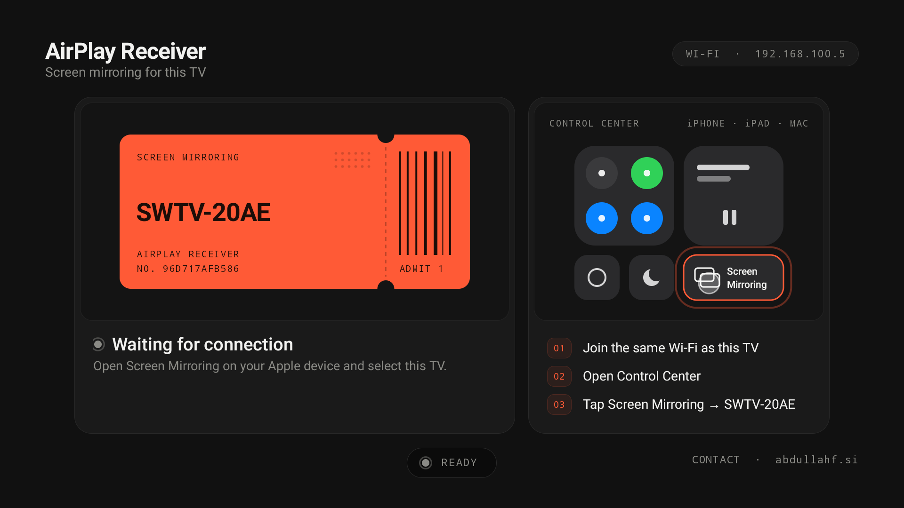

<div align="center">

# 📺 AirPlay Receiver for Android TV

**Mirror your iPhone, iPad or Mac to an Android TV — no extra app on the Apple device, no cables.**


</div>

---

## ✨ What is it?

A tiny, no-frills Android TV app that makes your TV show up in the **native Screen Mirroring menu** of iOS and macOS — just like an AirPlay-enabled LG or Samsung TV.

Open **Control Center → Screen Mirroring → pick your TV** and your screen appears on the TV, with sound.

- 🔍 **Appears in Apple's own menu** — nothing to install on the iPhone/iPad/Mac
- 🖥️ **Real screen mirroring** — real H.264 video decoded by the TV's hardware decoder
- 🔊 **Audio too** — AAC-ELD / AAC-LC, volume and mute follow your iPhone
- 🪶 **Very light** — one screen, no ads, no accounts, no analytics
- 👆 **Shows people where to tap** — an animated Control Center guide points at the Screen Mirroring button
- 📐 **Keeps aspect ratio** — portrait and landscape are letterboxed on the TV

> ⚠️ Not affiliated with Apple. "AirPlay" is a trademark of Apple Inc.

## 📸 How it looks



The TV waits on a dark home screen with its name on a pairing ticket, a pulsing status light and an animated Control Center guide. When mirroring starts, your screen takes over the whole TV; the home screen returns when you disconnect.

## 🚀 Install on your TV

### Option A — with the **Downloader** app (easiest) 📥

1. On your Android TV install **Downloader** (by AFTVnews) from the Play Store.
2. In *Settings → Allow Downloader to install unknown apps* switch it **on**.
3. Open Downloader and type this URL or this code (6322405):

   ```
   https://github.com/Traxbay/airplay-receiver-tv/releases/latest/download/AirPlay-Receiver.apk
   ```
4. Press **Go**, wait for the download, then **Install** → **Open**.

### Option B — with `adb` from a PC 🔌

1. TV: *Settings → Device Preferences → About* → tap **Build** 7 times, then enable **USB/Network debugging**.
2. On your PC:

   ```bash
   adb connect <TV_IP>:5555
   adb install AirPlay-Receiver.apk
   ```

## 🎬 How to use it

1. Put the iPhone / iPad / Mac on the **same Wi-Fi network** as the TV.
2. Open **AirPlay Receiver** on the TV and leave it in the foreground.
3. On the Apple device: **Control Center → Screen Mirroring** → choose your TV.
4. Stop mirroring from the same menu — the TV returns to the waiting screen.

## 🧪 Tested with

| Apple device | TV | Result |
|---|---|---|
| iPhone 14 Pro Max (iPhone14,3) | Skyworth Android TV, Android 11, 32-bit ARM | ✅ pairing, video, audio |
| iPad | — | ❓ not tested yet |
| macOS | — | ❓ not tested yet |

Reports with other devices are very welcome — please open an issue. 🙏

## 🛠️ How it is built

AirPlay mirroring is not just an mDNS announcement: the Apple device negotiates pairing, a FairPlay key exchange, an encrypted RTSP session and separate audio/video streams. Instead of rewriting all that, this project **ports the protocol core of [UxPlay](https://github.com/FDH2/UxPlay)** (a maintained open-source AirPlay mirroring server) to Android through the NDK and hands the decrypted media to Android's own hardware codecs.

```
 iPhone / iPad / Mac
        │  mDNS (_airplay._tcp, _raop._tcp)         ▲ discovery
        ▼                                            │
 ┌────────────────────────────  Android TV  ──────────────────────────┐
 │  Advertiser.kt ── Android NSD announces the TXT records built by C  │
 │                                                                     │
 │  libairplay.so (C, NDK)                                             │
 │   ├─ UxPlay: RAOP/RTSP server, pair-setup/verify, FairPlay SAP,     │
 │   │          AES-CTR decrypt, RTP/NTP timing                        │
 │   ├─ libplist (LGPL) + llhttp (MIT) + OpenSSL                       │
 │   └─ native.c: JNI bridge ── zero-copy DirectByteBuffers ──┐        │
 │                                                            ▼        │
 │  Native.kt ─► VideoDecoder.kt  MediaCodec (H.264/HEVC) ─► Surface  │
 │            └► AudioDecoder.kt  MediaCodec (AAC) ─► AudioTrack       │
 │  MainActivity.kt  one tiny screen + fullscreen SurfaceView          │
 └─────────────────────────────────────────────────────────────────────┘
```

| Piece | What it does |
|---|---|
| `app/src/main/cpp/uxplay/` | Vendored UxPlay protocol library (GPL-3) with GStreamer/Bonjour removed |
| `app/src/main/cpp/shim/dns_sd.h` | Tiny in-memory Bonjour stand-in so UxPlay can build its TXT records |
| `app/src/main/cpp/plist/` | Vendored libplist (LGPL-2.1) |
| `app/src/main/cpp/native.c` | JNI glue: starts the server, forwards video/audio/volume to Kotlin |
| `Advertiser.kt` | Registers both Bonjour services via Android `NsdManager` + a multicast lock |
| `VideoDecoder.kt` | Hardware decode straight to a `Surface`, low-latency mode, drops frames instead of queueing |
| `AudioDecoder.kt` | AAC-ELD / AAC-LC decode into a low-latency `AudioTrack` |

Only OpenSSL (via the official Android NDK prefab package) is pulled in as an external dependency.

### 🔨 Build it yourself

Requirements: JDK 17, Android SDK 34, NDK `26.1.10909125`, CMake `3.22.1`.

```bash
git clone https://github.com/Traxbay/airplay-receiver-tv.git
cd airplay-receiver-tv
./gradlew assembleDebug      # → app/build/outputs/apk/debug/app-debug.apk
```

For a signed release APK create a git-ignored `signing.properties`:

```properties
storeFile=/path/to/your.jks
storePassword=...
keyAlias=...
keyPassword=...
```

then run `./gradlew assembleRelease`. 

> 💡 Build from a folder whose path is plain ASCII — the NDK/CMake toolchain can fail on non-ASCII paths.

## 📋 Supported protocol & codecs

| | Supported |
|---|---|
| Protocol | AirPlay "legacy" screen mirroring (the path iOS/macOS still use for third-party receivers) |
| Pairing | Transient pairing, no PIN / password |
| Video | H.264 (hardware), HEVC if the TV decoder supports it |
| Audio | AAC-ELD (mirroring), AAC-LC |
| Network | Same local network, IPv4/IPv6 |

## 🚧 Known limitations (please read)

- ❌ **Not AirPlay 2.** AirPlay 2 features (multi-room, etc.) are not implemented and not claimed.
- ❌ **No DRM content.** Netflix, Apple TV+ and other protected apps show a black screen or refuse to mirror. This project does not try to bypass FairPlay *content* protection.
- ❌ **No ALAC / lossless audio**, no HLS/"video cast" mode — iOS is told to use AAC.
- ⚠️ **Single session & recovery are basic.** The server accepts what UxPlay accepts; a second device connecting, re-announcing after a Wi-Fi change, or renaming the TV are **not handled specially yet**. Restart the app if mirroring gets stuck.
- ⚠️ **Audio/video sync is not tuned.** Both play as soon as they are decoded; no A/V clock alignment yet.
- ⚠️ **Same Wi-Fi only.** Routers with "client isolation" or blocked multicast (mDNS) will hide the TV.
- ⚠️ The FairPlay key exchange is reverse-engineered interoperability code (from UxPlay). Apple can change it in a future iOS/macOS and break mirroring.
- 🧪 Only tested with one iPhone and one TV so far (see table above); no 30-minute soak test, no sleep/wake test yet.
- 🔌 The server listens on all network interfaces of the TV (like UxPlay); it is meant for trusted home networks.

## 🗺️ Roadmap

- [ ] Reject / message a second device while one is mirroring
- [ ] Re-advertise on network change, sleep/wake
- [ ] Audio-video sync using the sender's timestamps
- [ ] Foreground service so mirroring survives the app leaving the screen
- [ ] iPad and macOS test reports

## 📬 Contact

Questions, bug reports or business enquiries: **[abdullahf.si](https://abdullahf.si)** — or open an issue on this repo.

## 📜 License & credits

This project is released under the **GNU GPL v3** (see [LICENSE](LICENSE)) because it includes code from UxPlay.

| Component | License |
|---|---|
| [UxPlay](https://github.com/FDH2/UxPlay) (RPiPlay-derived protocol core, playfair) | GPL-3.0 |
| [libplist](https://github.com/libimobiledevice/libplist) | LGPL-2.1 |
| [llhttp](https://github.com/nodejs/llhttp) | MIT |
| OpenSSL 1.1.1 (Android NDK prefab) | OpenSSL / SSLeay |

Huge thanks to the UxPlay, RPiPlay and shairplay authors whose reverse-engineering work makes this possible. ❤️
